# audio_test — Bench harness for the audio library (ES24F project, stage 4)

Bench validation harness for the `components/audio` library
(decoder + player + PWM driver) for the **ELOCK ES242F (Tuya) smart lock
retrofit with an ESP32-S3**. The original board uses an FR8018H CPU feeding
a **CS8302M** class-D amplifier; this harness plays back the OEM prompts
extracted from the flash dump and validates timing, levels and sequencing
against oscilloscope captures of the original equipment.

**Status (2026-08-15): firmware passed on the bench.** Full suite OK
(`play`, `seq`, `say`, `vol`, `rep`), perfect timing, `underruns: 0`,
SD synchronized with audio, PWM idle at GND. One hardware item remains
open: [P-AUDIO-1](#open-item-p-audio-1--active-load-on-the-aout-net).

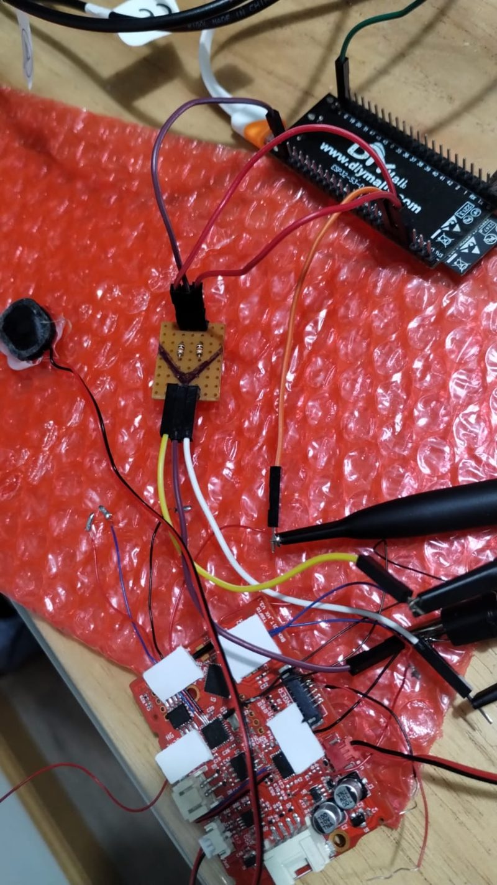

## Bench hardware

| Signal | GPIO | Destination |
|---|---|---|
| PWM phase | GPIO4 | RC (1 kΩ + 10 nF, fc ≈ 16 kHz) → **INP** net |
| PWM counter-phase | GPIO5 | RC (1 kΩ + 10 nF) → **INN** net |
| Amp shutdown (SD) | GPIO6 | CS8302M SD pin (HIGH = on) |

- Injection on the **AOUT net, before the 100 nF Cin** of the OEM front-end.
- **FR8018H disabled (reset held high), NOT removed.**
- Real CS8302M front-end (measured with **desoldered** parts, not in
  circuit): Rin = 100 kΩ ×2, Rf = 820 kΩ ×2, Cin = 100 nF ×2, cross-coupled
  feedback (VO+→IN−, VO−→IN+). **Gain Av = Rf/Rin = 8.2 V/V**.
  Consequence: the amp's clip threshold sits at ~0.8 Vpp differential at the
  input ≈ **vol 12/100**; the OEM deliberately runs the amp into saturation
  at high volumes (parity, not a defect).
- PWM carrier: exactly **156.25 kHz** (6.4 µs period). If the scope reads
  anything else on the raw square wave, that's undersampling: verify at
  2 µs/div.

## Firmware

- **`audio_decoder`**: decodes the OEM ADPCM format to 8 kHz PCM and
  upsamples ×4 to an internal **32 kHz** stream.
- **`audio_driver`**: 156.25 kHz differential MCPWM (GPIO4/5, hardware
  counter-phase) updated by a 32 kHz gptimer ISR. Anti-pop ramp, SD
  sequencing with **30 ms lead / 16 ms tail** (measured OEM parity), and at
  idle the timer stops and both outputs are **forced to GND**
  (EMI/power; transients are common-mode with the amp in shutdown →
  no differential pop).
- **`audio_player`**: task + 4096-sample ring buffer (128 ms);
  sequences, repeats and `say` (number dictation by prompt ids).
- 28 OEM prompts embedded in `main/*.raw` (extracted from the ZB25VQ64 dump).

## Build and flash

Pinned toolchain: **ESP-IDF v6.1-dev-6940-g08e0d30a74a** (project decision
D11). IDF 6.x porting notes already applied in `sdkconfig.defaults`:

- Kconfig `*_ISR_IRAM_SAFE` renamed to `*_ISR_CACHE_SAFE`
  (the 32 kHz timer runs even with the flash cache off).
- Split drivers: `esp_driver_mcpwm`, `esp_driver_gptimer`, `esp_driver_gpio`.
- MCPWM APIs: struct-based actions (the variadic variants were removed).

```sh
idf.py set-target esp32s3
idf.py build flash monitor
```

**Pitfall**: if the project was extracted from a zip with future timestamps,
CMake loops forever ("Re-running CMake"). Normalize mtimes:

```sh
find . -exec touch {} +
```

## Console (UART0, 115200)

| Command | Description |
|---|---|
| `play <id>` | play a clip (e.g. `play 13` = key beep) |
| `seq <id> [id...]` | clip sequence |
| `say <number>` | number dictation via prompts |
| `rep <id> <n>` | repeat n times (`0` = infinite, until `stop`) |
| `vol <0-100>` | volume |
| `stop` | stop playback |
| `under` | driver underruns |
| `clips` | list embedded ids |
| `tone <0-100\|off>` | fixed duty (diagnostics; wakes the PWM) |
| `diag` | driver/ring/ramp status (`pwm: on` or `off(GND)`) |

## Bench evidence

### OEM reference (FR8018H CPU, original equipment)

| Capture | What it documents |
|---|---|
| 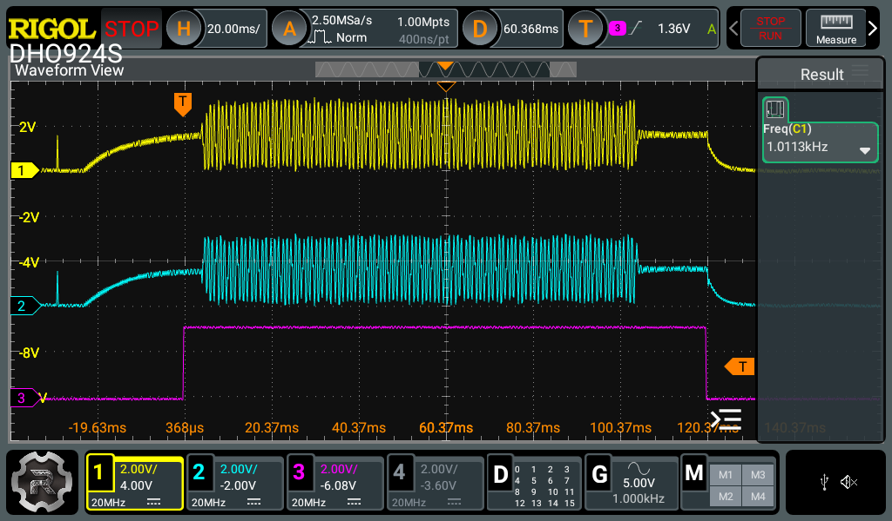 | OEM key beep post-RC: 1.0113 kHz / ~126 ms — A/B reference |
| 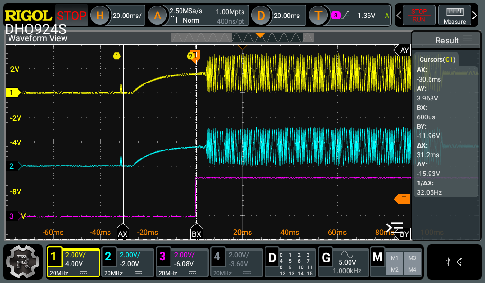 | SD lead **30 ms**: audio starts 30 ms after SD↑ |
| 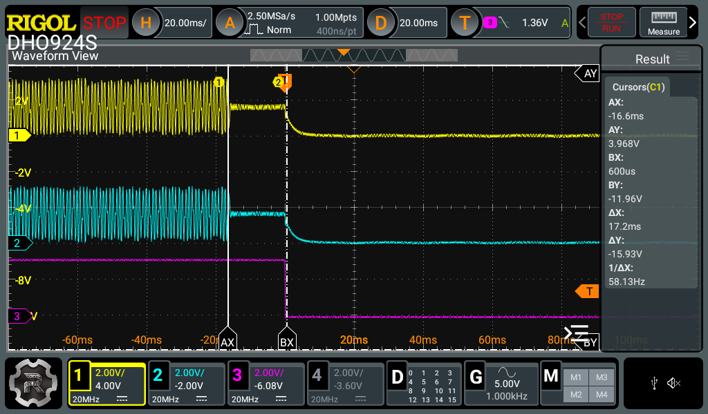 | SD tail **16 ms**: SD↓ 16 ms after audio ends |
| 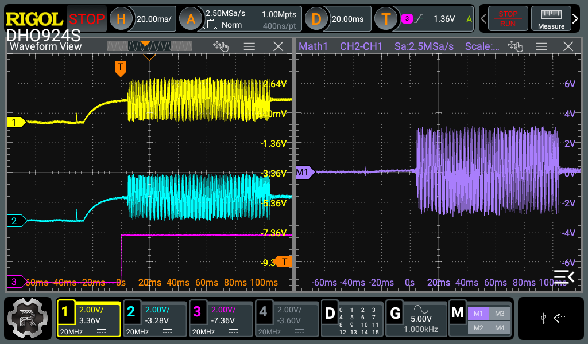 | Differential INP−INN (Math CH2−CH1): ~6 Vpp counter-phase |
| 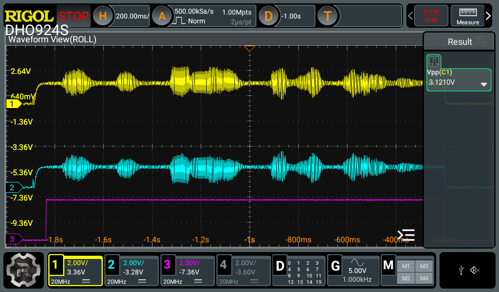 | Voice level reference (id 48): ≈3.1 Vpp |
| 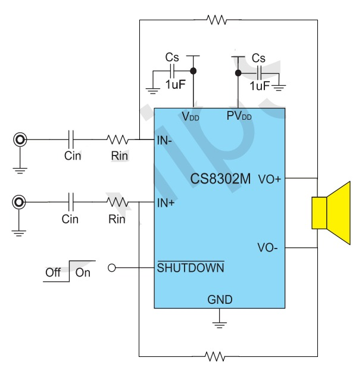 | OEM front-end schematic |
| 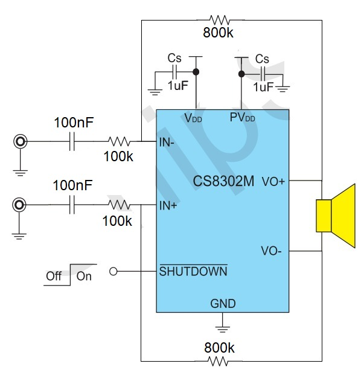 | REAL desoldered values: Rf 820 k / Rin 100 k / Cin 100 nF → Av = 8.2 |

### ESP32-S3 (this harness)

| Capture | What it documents |
|---|---|
| 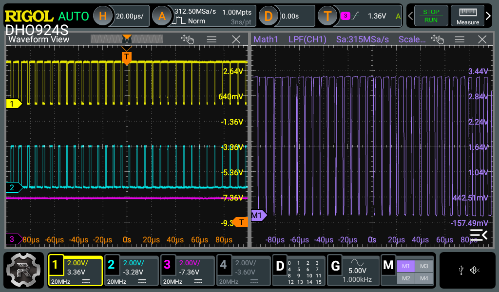 | `rep 13 0` at 20 µs/div: carrier with duty modulation and mirrored counter-phase on GPIO4/5 |
| 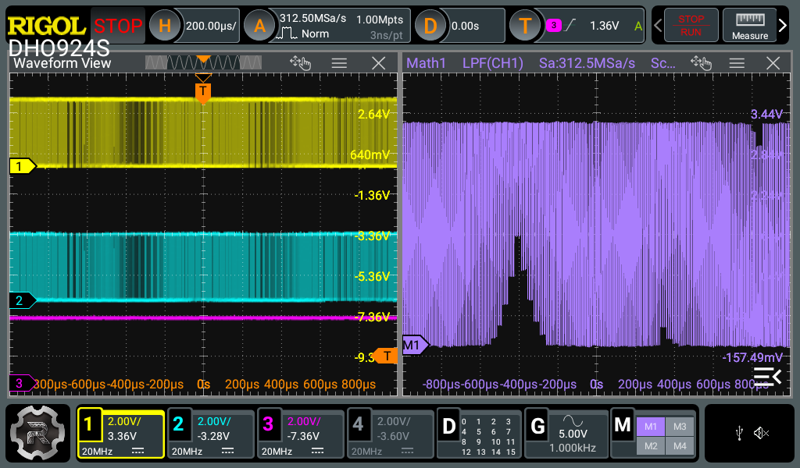 | `rep 13 0` at 200 µs/div: beep envelope at GPIO level (pre-RC) |
| 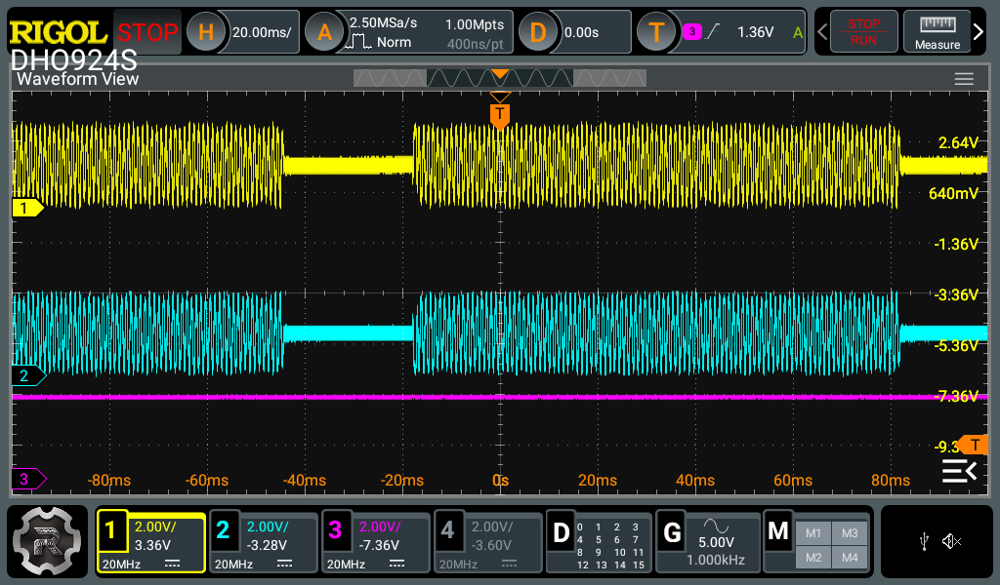 | Post-RC with `rep 13 0`: clean reconstructed beep envelope |
| 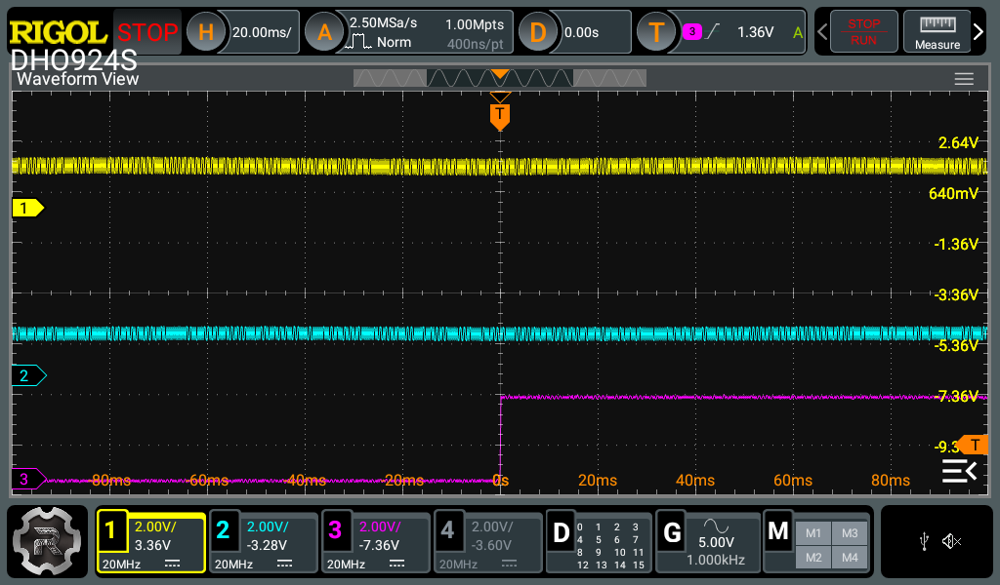 | **ramp=0 bug**: `play 13` drained in silence with perfect SD timing (128 ms ring > 126 ms beep → stop() during lead with ramp at 0). Fixed |
| 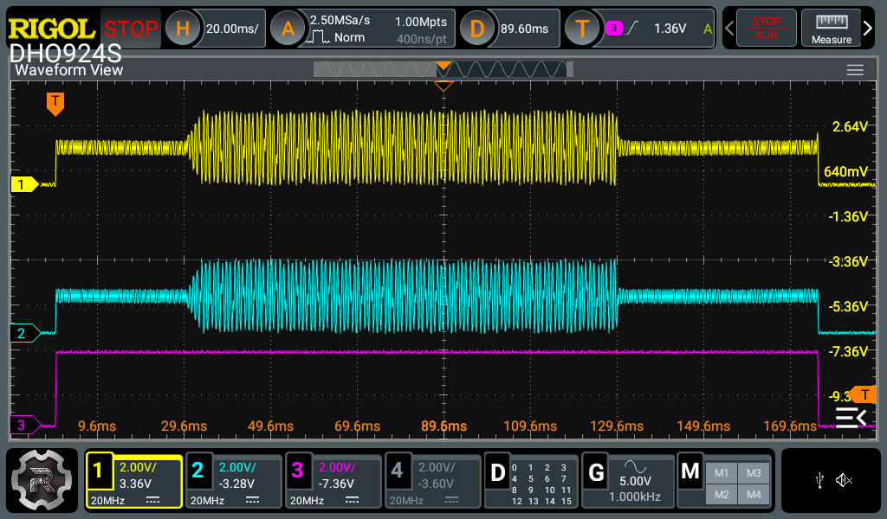 | Beep id 13 post-RC **without amp**: 1.96 Vpp envelope |
| 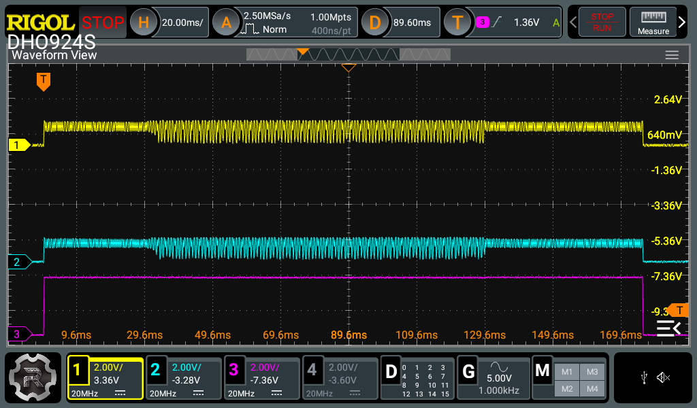 | Beep id 13 post-RC **with amp**: 0.86 Vpp (×0.44 → see P-AUDIO-1) |
| 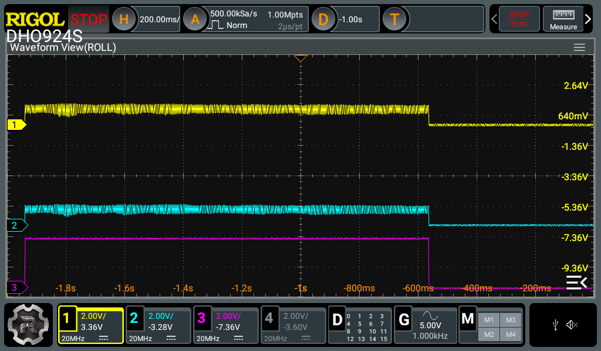 | Voice message id 232 with amp connected |
| 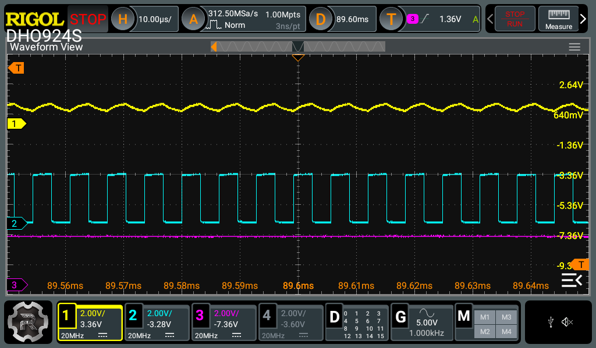 | Test A: GPIO pre-1k (cyan) with full swing and firm plateaus; post-RC node (yellow) sagged → the load is downstream of the 1k |
| 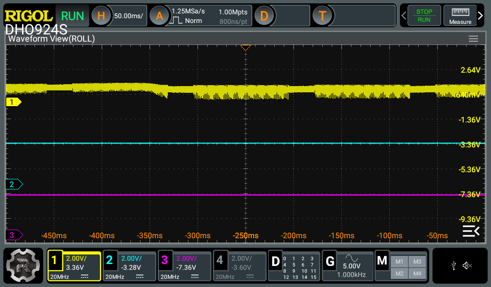 | Amp VDD flat during the beep → supply sag ruled out |
| 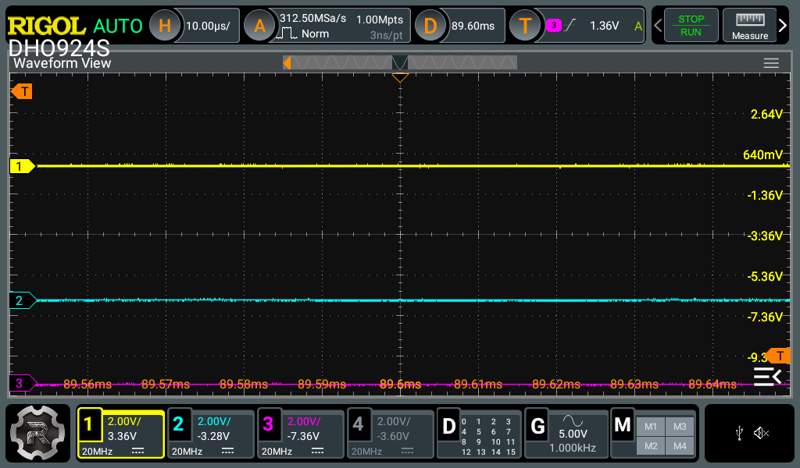 | Idle: RC output at GND (PWM off in IDLE) |

## Notable bugs found and fixed

1. **WDT ×2**: `tone` bypassed the state machine (full ring never drained)
   and `vTaskDelay(5 ms)` = 0 ticks at 100 Hz (busy-loop starving IDLE0).
   Fix: tone override at the end of the ISR + real delay in the player.
2. **Counter-phase**: direct inverted actions on gen_n (mirror of gen_p).
3. **ramp=0 bug** (the subtlest): the ring (4096 samples = 128 ms) exceeds
   the beep (126 ms) → the player wrote the whole clip during the lead
   without blocking and called `stop()` → STOPPING with ramp at 0 →
   **total silence with perfect SD timing**. `rep` masked it (it blocks on
   the full ring, never calls `stop()`). Fix: the ramp rises whenever the
   ISR consumes a real sample (RUNNING or STOPPING), and a stop during the
   lead still honors the 30 ms wake-up.

## Open item P-AUDIO-1 — active load on the AOUT net

With the amp connected, the post-RC envelope drops **1.96 → 0.86 Vpp
(×0.44, −7.2 dB)**; with a 1 kΩ series R and Rin = 100 kΩ it should be
−0.09 dB → there is an equivalent **~780 Ω** load on the AOUT net.

Ruled out with evidence (2026-08-15): VDD sag (flat), grounds (~0 Ω), GPIO
source (full swing with amp connected), static resistive path (board off:
>MΩ both ways) → **the load is active, it only exists with the board
powered**. The AOUT net reads **0.0000 V at idle** (board powered, CPU in
reset, ESP32 idle) → no active DC bias; consistent with an **active
pull-down** (e.g. the FR8018H AOUT anti-pop discharge FET while in reset)
or with hidden components under the keypad PCB.

**Decision: defer until the CPU is desoldered** (already-planned rework).
Re-entry checklist:

1. Re-run `rep 13 0` and measure the post-RC envelope → must return to
   ~1.96 Vpp.
2. If it persists, lift the blue keypad PCB and trace the AOUT net.
3. Once solved, redo the level calibration at VO±/speaker against the OEM
   and the Vpp A/B comparisons.

Note: the audible "clipping" at vol ≥ 70 is **OEM parity** (Av = 8.2 → clip
threshold ≈ vol 12). For clean test audio use `vol 10`.

## References

- Full stage documentation: `HANDOFF_Audio_CS8302.md` (project notes,
  outside this repo).
- Datasheets: CS8302M (ChipSourceTek), FR8018H (Freqchip), ESP32-S3.
